<h1 align="center">AptIQ: Adaptive Aptitude Trainer</h1>

<p align="center"><b>Diagnose. Practice. Improve.</b><br/>
Placement-style aptitude tests, topic-level weakness diagnosis and an adaptive practice engine for campus recruitment preparation.</p>

<p align="center">
  <a href="https://github.com/nvaltryek-001/AptIQ/actions/workflows/ci.yml"></a>
  
  
  
  
  
  
</p>

<p align="center"><a href="https://apt-iq-alpha.vercel.app"><b>Live demo</b></a> &nbsp;|&nbsp; <a href="#quick-start">Quick start</a> &nbsp;|&nbsp; <a href="#how-the-adaptive-engine-works">How it adapts</a> &nbsp;|&nbsp; <a href="#api-reference">API</a></p>

---

## Demo

<p align="center">
  <a href="docs/demo/aptiq-demo.mp4">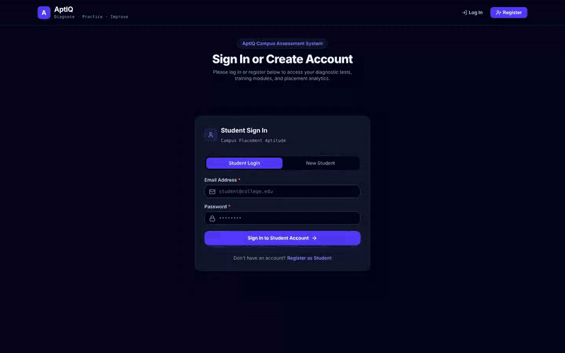</a>
  <br/><sub>A full student journey recorded from a local run (about 55 s): sign in → choose a test → 20-question diagnostic → report with weak topics → targeted training → adaptive practice → progress → updated dashboard. <a href="docs/demo/aptiq-demo.mp4"><b>Watch the MP4</b></a>.</sub>
</p>

**Try it yourself:** sign in with the seeded demo account `student@aptiq.com` / `Student@123`, or register a new student.

## Screenshots

| Sign in | Student dashboard (after one test) |
|---|---|
| 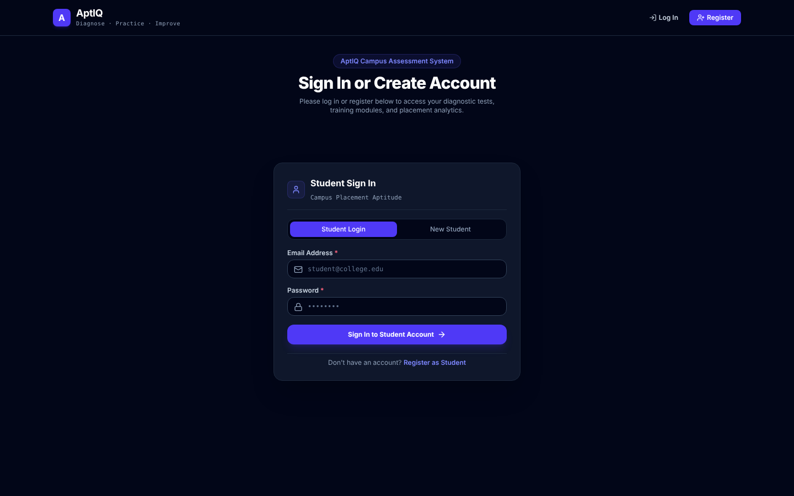 | 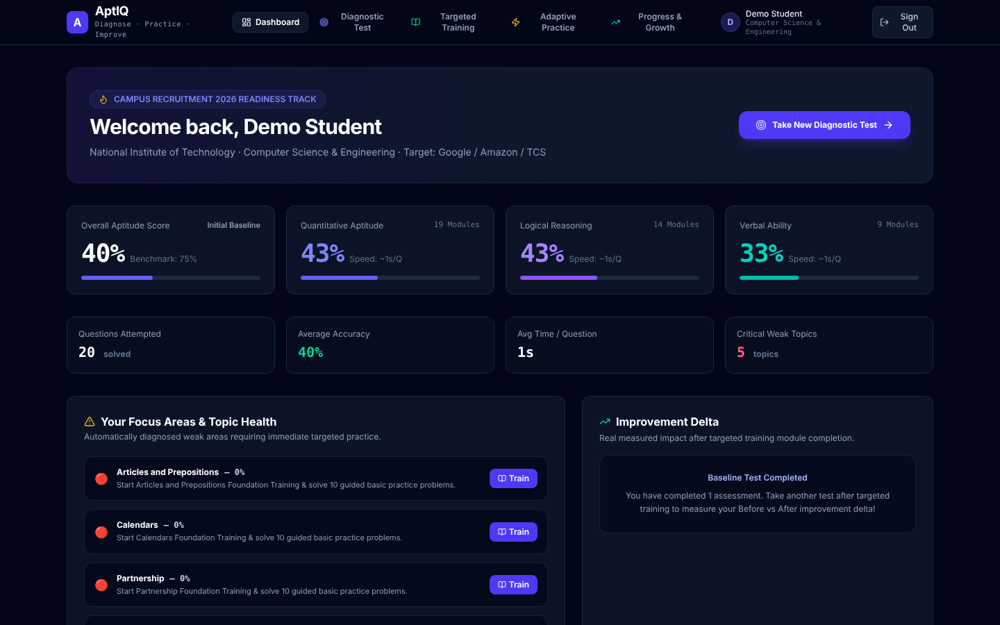 |
| **Choose an assessment blueprint** | **Timed assessment with question palette** |
| 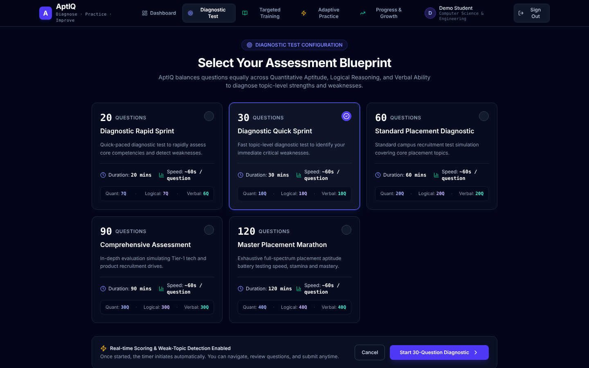 | 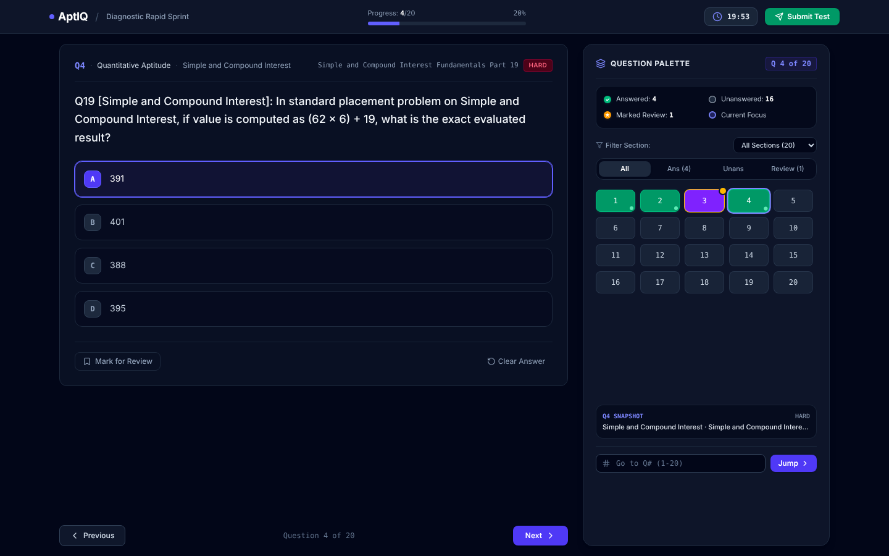 |
| **Diagnostic report and weakness engine** | **Targeted training module** |
| 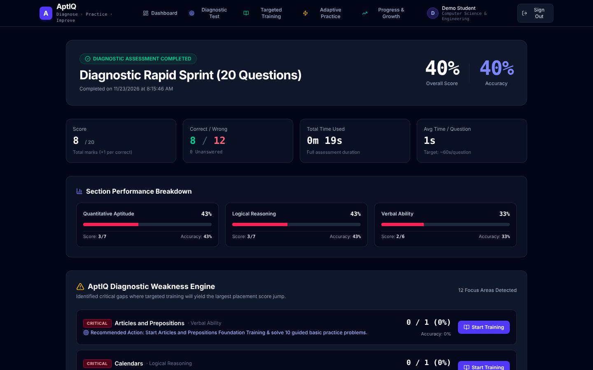 | 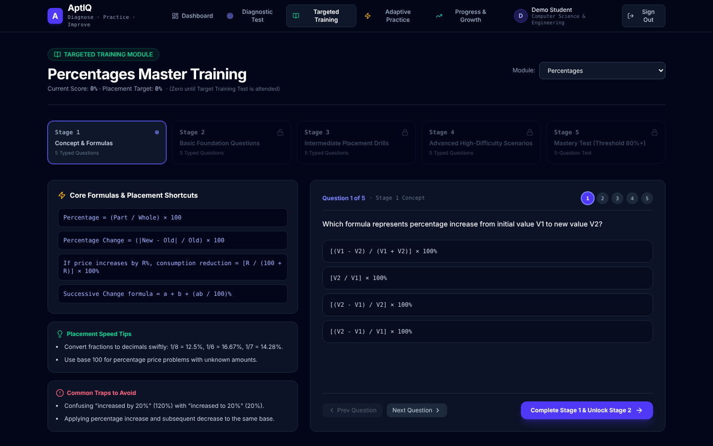 |
| **Adaptive practice with instant feedback** | **Progress and growth tracking** |
| 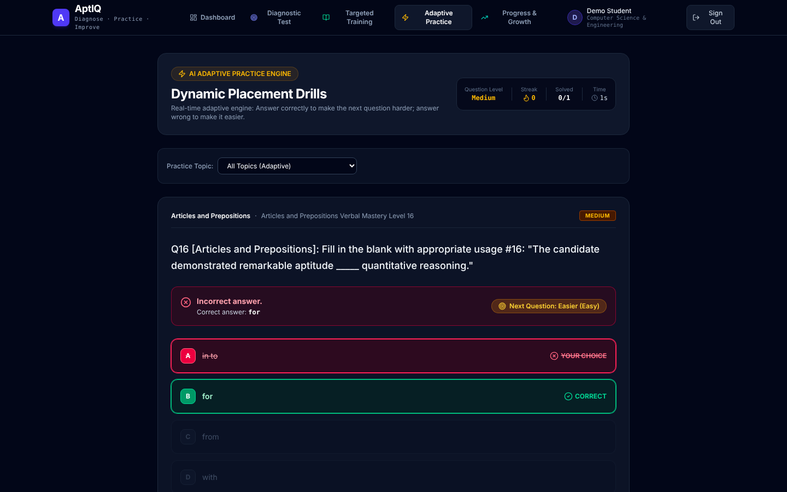 | 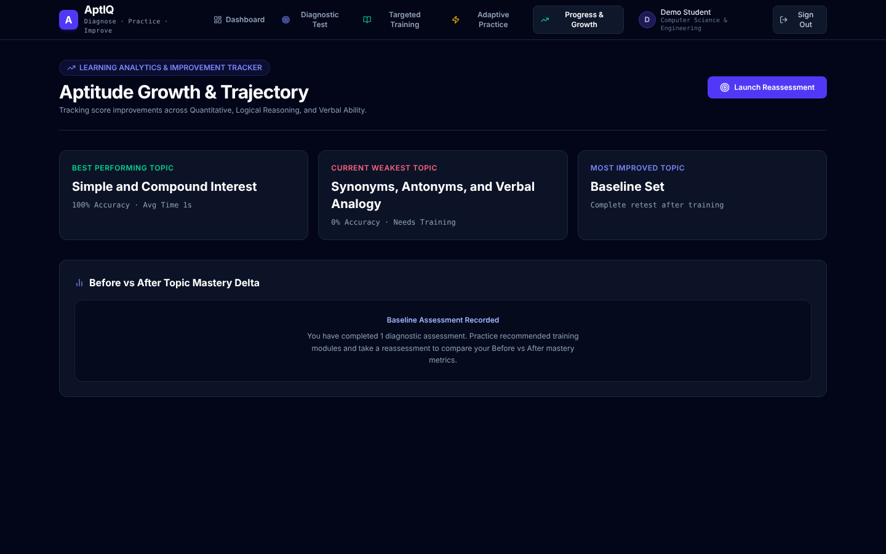 |

<p align="center">
  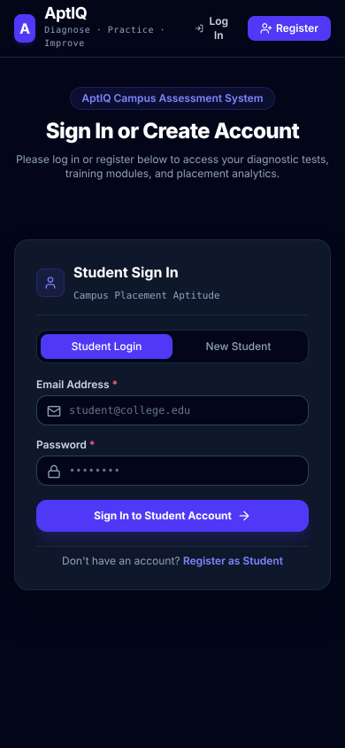&nbsp;&nbsp;
  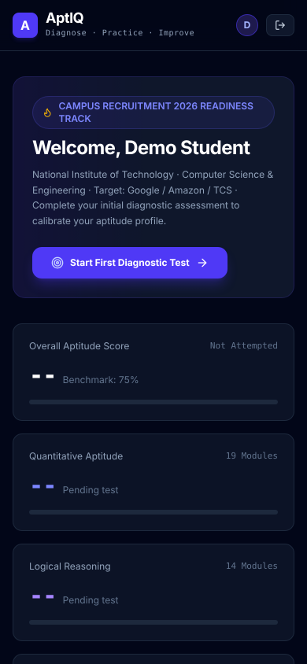
  <br/><sub>Responsive layout on a 390 px phone screen. Full-page captures: <a href="docs/screenshots/02-dashboard-full.png">dashboard</a>, <a href="docs/screenshots/05-results-full.png">diagnostic report</a>.</sub>
</p>

---

## Features

| Area | What the student gets |
|---|---|
| **Diagnostic tests** | Five blueprints (20, 30, 60, 90 or 120 questions), balanced across Quantitative Aptitude, Logical Reasoning and Verbal Ability, with ~60 s per question. Countdown timer, question palette, filters (answered / unanswered / marked), mark-for-review, jump-to-question and auto-submit. |
| **Diagnostic report** | Score, accuracy, correct / wrong / unanswered, time used, a per-section breakdown and a **weakness engine** that grades every topic: Critical (<40%), Weak (<60%), Average (<75%), Strong (<90%) or Excellent. Each grade comes with a recommended next step and a one-click link to training. |
| **Targeted training** | Staged modules per topic with formula-style questions, step navigation and stage unlocking. |
| **Adaptive practice** | One question at a time. A correct answer raises the difficulty, a wrong one lowers it. Weak topics (<60% after 2+ attempts) are prioritised 70% of the time, recently seen questions are avoided, and every answer shows feedback plus an explanation. |
| **Progress & growth** | Best and weakest topics, plus before-and-after topic mastery across repeated assessments. |
| **Dashboard** | Overall and per-section scores against a 75% benchmark, attempts, accuracy, average time, critical topics and recommended focus areas. |
| **Accounts** | Works out of the box with local accounts. Optionally uses Firebase Authentication and Firestore when configured. |

## Question bank

`src/data/questionBank.json` (mirrored in `data/questionBank.json` for the tooling) holds **840 questions across 42 topics** (20 per topic). Each question has 4 options, a correct answer, an explanation, a time limit and tags.

| Section | Topics | Easy | Medium | Hard | Total |
|---|---|---|---|---|---|
| Quantitative Aptitude | 19 | 114 | 190 | 76 | 380 |
| Logical Reasoning | 14 | 84 | 140 | 56 | 280 |
| Verbal Ability | 9 | 54 | 90 | 36 | 180 |
| **Total** | **42** | **252** | **420** | **168** | **840** |

Time limits are 50 s (Easy), 65 s (Medium) and 85 s (Hard). The app removes near-duplicate questions at load time: after normalising numbering and punctuation, **770 questions are unique**. Seven Verbal Ability topics keep 10 unique questions each and the rest keep 20. Questions are generated from parameterised templates by `scripts/generateAllQuestions.ts`, so they test procedure more than reading depth (see [Limitations](#limitations)).

## How the adaptive engine works

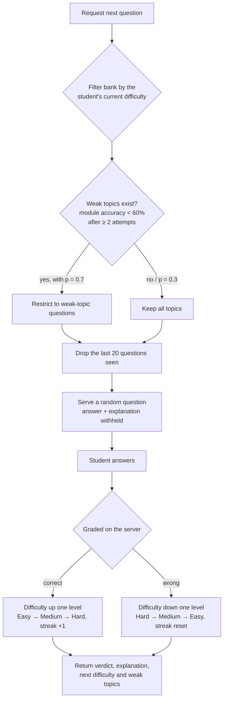

Correct answers and explanations never reach the browser before the student submits, and grading happens in `POST /api/adaptive/submit`. If the API is unreachable, `src/services/adaptivePracticeService.ts` runs the same policy locally.

> **Fixed in this release:** weak-topic targeting used each question's per-item `topic` label, which is unique to every question, so the "≥ 2 attempts" rule could never trigger. In a check against the original server, a student who answered 40 questions wrong was assigned **no** weak topics. Statistics are now aggregated by module (the 42 syllabus topics), in both the server and the offline engine. After the fix, about 70% of the next questions target the weak modules, as designed.

## Architecture

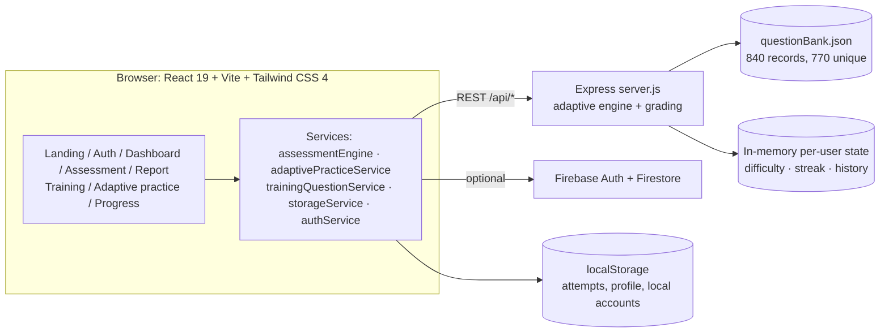

## Project structure

```
AptIQ/
├── server.js                      Express API: adaptive engine, grading, static hosting of dist/
├── index.html                     Vite entry
├── src/
│   ├── App.tsx                    App shell and tab routing
│   ├── components/
│   │   ├── landing/               Landing and sign-in hero
│   │   ├── auth/                  Login / registration modal
│   │   ├── dashboard/             Student dashboard
│   │   ├── assessment/            Blueprint picker, test runner, palette, report
│   │   ├── training/              Targeted training modules
│   │   ├── practice/              Adaptive practice view
│   │   ├── progress/              Growth and topic-mastery view
│   │   ├── admin/                 Admin dashboard component (not yet routed, see Roadmap)
│   │   └── layout/                Navbar
│   ├── services/                  Assessment engine, adaptive engine, storage, auth, Firebase
│   ├── hooks/useAssessmentTimer.ts
│   ├── types/assessment.ts
│   └── data/questionBank.json     Question bank used by the app
├── data/                          Question-bank mirror + validation report
├── scripts/                       Question generation and validation (tsx)
├── tests/questionBank.test.mjs    Bank integrity tests (node:test)
├── firestore.rules, storage.rules Firebase security rules
└── docs/                          Demo video, GIF and screenshots
```

## Quick start

**Requirements:** Node.js 20+ and npm.

```bash
git clone https://github.com/nvaltryek-001/AptIQ.git
cd AptIQ
npm install
cp .env.example .env        # optional: Firebase config, see below
```

**Development** (two terminals):

```bash
npm run dev                 # frontend on http://localhost:3000
PORT=3001 npm start         # adaptive API on http://localhost:3001
```

In development the adaptive practice view falls back to its local engine when the API isn't on the same origin. To use the server engine during development, add a proxy to `vite.config.ts` (`server.proxy = { '/api': 'http://localhost:3001' }`).

**Production** (one process serves both the API and the built frontend):

```bash
npm run build
npm start                   # http://localhost:3000
```

### Environment variables

| Variable | Required | Purpose |
|---|---|---|
| `PORT` | no | Port for `server.js` (default `3000`) |
| `VITE_FIREBASE_API_KEY`, `VITE_FIREBASE_AUTH_DOMAIN`, `VITE_FIREBASE_PROJECT_ID`, `VITE_FIREBASE_STORAGE_BUCKET`, `VITE_FIREBASE_MESSAGING_SENDER_ID`, `VITE_FIREBASE_APP_ID` | no | Enable Firebase Auth and Firestore. Without them the app uses local accounts. |
| `GEMINI_API_KEY` | no | Reserved for AI features; not required by the current code paths |
| `APP_URL` | no | Public URL of the deployment |

### Scripts

| Command | What it does |
|---|---|
| `npm run dev` | Vite dev server on port 3000 |
| `npm start` | Express API (and `dist/` if built) |
| `npm run build` | Production build to `dist/` |
| `npm test` | Question-bank integrity tests |
| `npm run lint` | TypeScript type-check |
| `npm run validate:questions` | Full bank validation, writes `data/validation-report.json` |
| `npm run clean` | Remove `dist/` |

## API reference

| Method | Route | Body / query | Response |
|---|---|---|---|
| `GET` | `/api/health` | none | `{ status, timestamp }` |
| `GET` | `/api/adaptive/question` | `userId`, optional `module` | `{ question, adaptiveState, servedWeakTopic }`. The question has no answer or explanation. |
| `POST` | `/api/adaptive/submit` | `{ userId, questionId, selectedOption, timeTaken }` | `{ isCorrect, correctAnswer, explanation, nextDifficulty, streak, weakTopics, totalSolved, totalCorrect, ... }` |
| `POST` | `/api/auth/verify-status` | `{ email, isEmailVerified }` | `200 { authorized: true }` or `403` |

```bash
curl "http://localhost:3000/api/adaptive/question?userId=demo"
curl -X POST http://localhost:3000/api/adaptive/submit -H "Content-Type: application/json" \
     -d '{"userId":"demo","questionId":"QA-AGE-010","selectedOption":"105"}'
```

## Testing and CI

```bash
npm test
```

The tests check that the bank has 840 well-formed records across 3 sections and 42 topics, unique IDs, four distinct options per question with the answer among them, at least 10 unique questions per topic after de-duplication, and that `data/` and `src/data/` agree. GitHub Actions runs the tests, a production build and an API smoke test on every push and pull request.

## Deployment

- **Vercel (frontend):** build `npm run build`, output `dist/`. Add the `VITE_FIREBASE_*` variables if you use Firebase. The adaptive view then uses its local engine.
- **Full stack (API + frontend):** any Node host (Render, Railway, Fly.io, a VM): `npm ci && npm run build && npm start`.
- **Firebase:** enable Email/Password (or Email-link) sign-in, then deploy `firestore.rules` and `storage.rules`.

## Limitations

- **Local accounts are for demos only:** without Firebase, accounts and passwords live in the browser's `localStorage` in plain text. Configure Firebase Authentication before real users sign up.
- **Server state is in memory:** the adaptive state resets when the server restarts. A database (e.g. Firestore) is needed for persistence across devices.
- **Template-generated questions:** they test computation and procedure. Reading comprehension and critical reasoning items would benefit from human-written passages. 70 near-duplicates are filtered at load time.
- **Admin dashboard:** the component exists but isn't routed in the app yet.

## Roadmap

- Route the admin dashboard behind an admin role (question management, cohort analytics).
- Persist adaptive state in Firestore; add per-topic ability estimates (e.g. Elo-style ratings) instead of three fixed difficulty levels.
- Grow the Verbal Ability bank to 20 unique questions per topic with human-written passages.
- Export reports as PDF; add placement-company-specific mock tests.

## Contributing

Issues and pull requests are welcome. Please run `npm test` and `npm run lint` before opening a PR, and keep both copies of the question bank in sync (`scripts/generateAllQuestions.ts` writes both).
