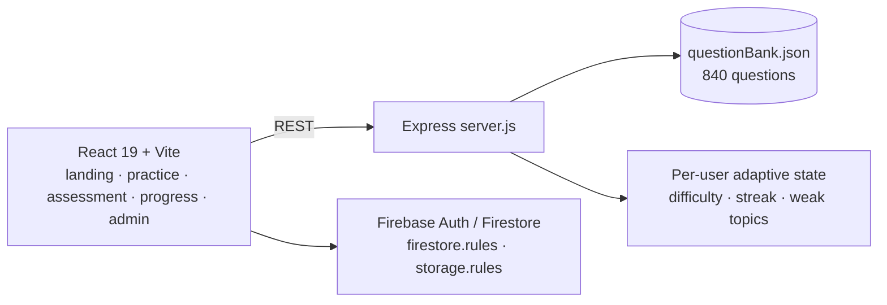

<h1 align="center">🧮 AptIQ: Adaptive Aptitude Trainer</h1>

<p align="center"><b>An aptitude-practice app that adapts to you: questions get harder when you answer correctly and focus on topics where your accuracy is below 60%.</b></p>

<p align="center">
  
  
  
  
  
</p>

<p align="center"><a href="https://apt-iq-alpha.vercel.app"><b>Live demo →</b></a></p>

## Highlights

- **840-question bank** in `data/questionBank.json`: Quantitative Aptitude 380, Logical Reasoning 280 and Verbal Ability 180 (252 easy, 420 medium, 168 hard), each with an explanation, a time limit and tags.
- **Adaptive engine** (`server.js`):
  - Serves a question at your current difficulty, optionally filtered by module.
  - 70% of the time, picks from your **weak topics** (accuracy under 60% after at least 2 attempts).
  - Avoids repeating recently asked questions.
  - Raises the difficulty after a correct answer and tracks your streak.
- **Modes:** landing, auth, dashboard, practice, timed assessment, training, progress and admin views (`src/components/*`).
- **Quality tooling:** `scripts/validateQuestions.ts` checks the bank and writes `data/validation-report.json`.

## API

| Method | Route | Purpose |
|---|---|---|
| GET | `/api/health` | Liveness check |
| GET | `/api/adaptive/question?userId=&module=` | Next adaptive question |
| POST | `/api/adaptive/submit` | Grade an answer and update difficulty, streak and weak topics |
| POST | `/api/auth/verify-status` | Auth status check |

## Architecture



## Run locally

```bash
git clone https://github.com/nvaltryek-001/AptIQ && cd AptIQ
npm install
cp .env.example .env     # add Firebase web config; GEMINI_API_KEY optional
npm run dev              # frontend on :3000
node server.js           # adaptive API on PORT (default 3000; set PORT=3001 if running both)
```

Type-check with `npm run lint`.

## Limitations

- Adaptive state is held in server memory, so it resets when the server restarts.
- No automated tests yet.
